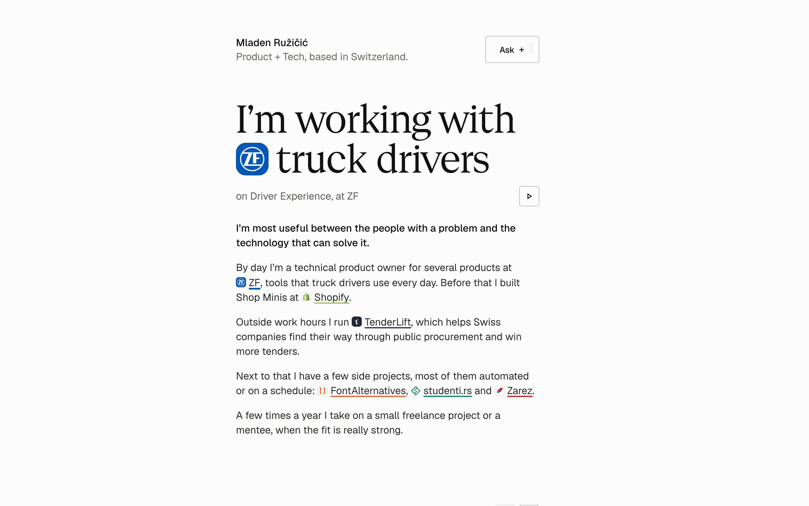

# mladenruzicic.com



The personal site of Mladen Ružičić: who he is, what he has built and what
happened to it, mentoring, and a press kit. Live at
[mladenruzicic.com](https://mladenruzicic.com).

Built with Next.js 16 (App Router, Cache Components, React Compiler), React 19,
Tailwind CSS 4 and TypeScript. Every page is prerendered. For machines there is
`/llms.txt`, `/llms-full.txt`, a markdown version of every page (`.md`, or
`Accept: text/markdown`), JSON-LD, and a read-only MCP endpoint at `/mcp`.

## Running it

Node 22 and pnpm (the version is pinned in `package.json`).

```bash
pnpm install
pnpm dev            # http://localhost:3000
pnpm build          # production build
pnpm start          # serve the build
pnpm lint
pnpm typecheck
pnpm format:check
```

Every environment variable is optional: without them the site builds and
runs, the newsletter says sign-up is offline and Ask answers its prepared
questions. Set them in the hosting environment, never in the repository.

| Variable                         | What it turns on                                                                                                      |
| -------------------------------- | --------------------------------------------------------------------------------------------------------------------- |
| `CONVERTKIT_API_KEY`             | Newsletter sign-ups (Kit v3), server only.                                                                            |
| `NEXT_PUBLIC_TURNSTILE_SITE_KEY` | The Turnstile widget's site key (public), for Ask and the newsletter.                                                 |
| `TURNSTILE_SECRET_KEY`           | The same widget's secret, server only. With the site key, the newsletter's bot check (`lib/newsletter/turnstile.ts`). |
| `NEXT_PUBLIC_ASK_ENDPOINT`       | With the site key, Ask's typed questions go to the Worker (see `workers/ask/README.md`).                              |
| `NEXT_PUBLIC_FATHOM_SITE_ID`     | Fathom page views.                                                                                                    |

Tests are Playwright end-to-end tests; see [`tests/README.md`](tests/README.md).

```bash
pnpm exec playwright install chromium webkit   # once
pnpm build && CI=1 pnpm test:e2e               # what CI runs
```

## Where things live

- `content/`: all copy and data (pages, products, case studies in
  `content/work/*.mdx`, diagrams), validated by the zod schemas in
  `lib/content/` when the site builds.
- `app/`: routes and components; area styles in `app/styles/`, design tokens
  in `app/globals.css`.
- `lib/`: content loaders, SEO and machine-readable outputs, the Ask context.
- `workers/ask/`: the Cloudflare Worker behind the "Ask" panel's typed
  questions (see its README).
- `public/`: images, clips and logos, nothing else (everything there is
  served).

## Licence

See [LICENSE.md](./LICENSE.md): an MIT-based licence with conditions of its
own. Third-party logos and artwork under `public/` belong to their owners;
material that needs a credit is credited on the page where it appears.
